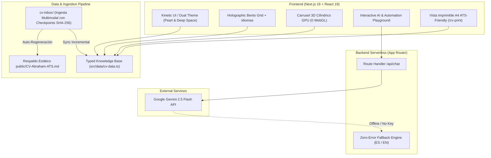

# Abraham Martín Heras · Kinetic Full Stack AI & Automation Portfolio

[](https://nextjs.org/)
[](https://react.dev/)
[](https://www.typescriptlang.org/)
[](https://tailwindcss.com/)
[](https://ai.google.dev/)
[](#-bilingual-support--language-competencies)

> **Ingeniería Full Stack & IA con mentalidad de operaciones reales.**  
> Transformo cuellos de botella operativos, hojas de cálculo caóticas y tareas manuales repetitivas en sistemas autónomos, agentes de IA y aplicaciones web de alto rendimiento.

---

## 🧭 Visión General / Project Overview

Este proyecto no es una simple landing page estática; es un **ecosistema técnico interactivo de alta gama** diseñado para demostrar simultáneamente dos capacidades críticas:
1. **Perfil Híbrido Real:** Más de 10 años de experiencia supervisando operaciones críticas y logística ferroviaria (**Serveo**, **Cremonini**, **Wagons-Lits**), combinados con certificaciones oficiales de primer nivel (**Google Cybersecurity 260h**, **Python 260h**, **Google AI Professional**, **PAU +25 con nota 8,80**).
2. **Ingeniería de Software Moderna & Vibe Coding:** Arquitectura en Next.js 16 y React 19 con tipado estricto, 60 FPS garantizados mediante aceleración GPU por compositor, soporte bilingüe instantáneo (ES/EN) y una suite de 3 miniaplicaciones funcionales en el Playground.

---

## 🏗️ Arquitectura del Sistema / System Architecture



---

## ⚡ Características Principales / Core Features

### 1. Dual-Theme Dinámico: "Holographic Pearl" & "Deep Space"
- **Holographic Pearl (Modo Claro):** Fondo blanco perla translúcido con halos orgánicos en tonos lavanda/cian, texto carbón de alto contraste y tarjetas glassmorphism pulidas.
- **Deep Space (Modo Oscuro):** Fondo índigo cósmico/azul medianoche (`#060913`), bordes luminiscentes cian/violeta y tarjetas `bg-slate-900/80` de inspiración aeroespacial.
- Sin flashes de hidratación (`suppressHydrationWarning`), sincronizado con `localStorage` y preferencias del sistema.

### 2. Soporte Bilingüe Instantáneo (ES | EN)
- Selector reactivo `ES | EN` en la barra superior con `whitespace-nowrap`.
- Conmuta en tiempo real la totalidad de la interfaz (Hero, Bento Grid, Idiomas, Playground, Timeline y respuestas del Asistente Contextual) sin recargar la página.
- **Bloque Visual de Idiomas:**
  * **Castellano / Spanish:** Nativo (C2) — 100%
  * **Valenciano / Catalán:** Competencia profesional fluida (B2-C1) — 85%
  * **Inglés (Technical English):** Nivel Medio General / Alto en lectura de documentación de software, RFCs, papers de IA y APIs — 80%

### 3. Generador de CV Imprimible en PDF ATS-Friendly (`/cv-print`)
- Vista ejecutiva A4 con alta legibilidad tipográfica y contraste optimizado para ATS (InfoJobs, LinkedIn, Workday).
- Reglas `@media print` dedicadas (`size: A4 portrait; margin: 8mm 10mm;`), ocultando barras flotantes y fondos de pantalla innecesarios.
- Botón **"Copiar Formato ATS"** en 1 clic para pegar el texto limpio en formularios de portales de empleo.
- Conexión directa desde los botones de descarga del Header y Hero respetando el idioma activo (`?lang=es` / `?lang=en`).

### 4. Carrusel Cilíndrico 3D de Certificaciones (Cero WebGL)
- Rendimiento puro a 60 FPS implementado con **transformaciones CSS 3D nativas** (`transform-style: preserve-3d; perspective: 1200px`) y resortes `useSpring` de Framer Motion.
- **Matemática Cilíndrica Precisa:**
  $$\text{radius} = \max\left(380, \frac{\text{cardWidth} \times N}{2\pi}\right)$$
- **Depth Culling a 75°:** Las tarjetas con ángulo relativo $> 75^\circ$ se ocultan estrictamente (`opacity-0 pointer-events-none invisible`) evitando colisiones visuales de fondo.
- Conmutador para reclutadores de RRHH entre **Cilindro 3D** y **Cuadrícula Completa Desplegable**.

---

## 🎮 Playground Técnico en Vivo (3 Miniaplicaciones)

| Pestaña | Nombre | Stack | Propósito de Negocio |
|---|---|---|---|
| **Tab 1** | **Smart Data Cleaner** | TypeScript · Pandas Pattern · AI Normalizer | Limpieza y normalización de fechas caóticas (`DD/MM/YY` vs `ISO`), importes heterogéneos y duplicados. Visualización del *Antes $\to$ Después* y botón *"Copiar para Excel"* (`\t`). |
| **Tab 2** | **Workflow Pipeline Simulator** | n8n · Playwright · Python Worker | Simulación interactiva de 4 nodos (Webhook $\to$ Bot Playwright $\to$ IA $\to$ ERP) con telemetría en vivo, sin saltos de scroll y con métricas ejecutivas de ahorro. |
| **Tab 3** | **Ask My CV (Asistente Contextual)** | Gemini 2.5 Flash · RAG · Serverless Route | Chat interactivo con guardrails deterministas, multi-turn history y un motor local de fallback rico con 0% tasa de fallo si no hay API key disponible. |

---

## 📥 Pipeline Incremental de Ingesta Curricular (`cv-inbox`)

El directorio `cv-inbox/` aloja un pipeline de ingesta multimodal automatizado (`sync-cv.mjs`):
1. **Checkpoints SHA-256:** Cada archivo (diploma PDF, certificado JPG, nota de prensa) es hasheado criptográficamente en `.checkpoint.json`. Si un documento ya fue procesado, se omite con **0 tokens consumidos**.
2. **Extracción Multimodal con Gemini 2.5 Flash:** Analiza el contenido visual y textual del documento, extrayendo horas lectivas, competencias y entidades emisoras.
3. **Filtrado Estricto de PII:** Sanitiza automáticamente números de DNI/NIE, teléfonos personales, domicilios o firmas antes de actualizar el código fuente.
4. **Auto-Sincronización Bilingüe & ATS:** Actualiza `src/data/cv-data.ts` (en ramas `es` y `en`) y regenera automáticamente el archivo estático de respaldo `public/CV-Abraham-ATS.md`.

```bash
# Ejecutar sincronización manual de la bandeja cv-inbox/
node cv-inbox/sync-cv.mjs
```

---

## 🚀 Puesta en Marcha Local / Getting Started

### Prerrequisitos
- Node.js 18.18+ o Node.js 20+
- Gestor de paquetes: `npm`, `pnpm` o `yarn`

### Instalación
```bash
# 1. Clonar el repositorio
git clone https://github.com/superabienator/abraham-martin-heras.git
cd abraham-martin-heras

# 2. Instalar dependencias
npm install

# 3. Configurar variables de entorno (opcional para el chat de Gemini)
cp .env.example .env.local
# Añade tu GEMINI_API_KEY si deseas inferencia en vivo con LLM (si no, el fallback local responderá al 100%)

# 4. Iniciar servidor de desarrollo
npm run dev
```

Abre [http://localhost:3000](http://localhost:3000) en tu navegador.

### Scripts Disponibles
- `npm run dev`: Inicia el servidor de desarrollo en Turbopack.
- `npm run build`: Genera el build estático y serverless de producción.
- `npm run lint`: Ejecuta el linter ESLint sin advertencias.
- `npx tsc --noEmit`: Validación estricta de tipos de TypeScript.

---

## 🔒 Auditoría de Rendimiento & Buenas Prácticas

- **60 FPS & First-Scroll Jank Elimination:** Se han eliminado todas las propiedades de pintura pesada (`filter: blur(...)`) en eventos de scroll `whileInView`, utilizando exclusivamente propiedades aceleradas por hardware GPU (`opacity` y `translate3d`).
- **Scroll Confinado:** Prohibido el uso de `window.scrollTo` o `element.scrollIntoView()` en componentes dinámicos; el desplazamiento se gestiona internamente mediante `scrollTop = scrollHeight` en contenedores de altura controlada.
- **Cero Fugas Técnicas:** Interfaz pública 100% ejecutiva, sin menciones a nombres de archivos internos o scripts de desarrollo.

---

## 📄 Licencia & Contacto

Desarrollado por **Abraham Martín Heras**.  
- **Email:** [contacto@abraham.dev](mailto:contacto@abraham.dev)  
- **LinkedIn:** [in/abraham-martin-heras](https://linkedin.com/in/abraham-martin-heras)  
- **GitHub:** [@superabienator](https://github.com/superabienator/abraham-martin-heras)
